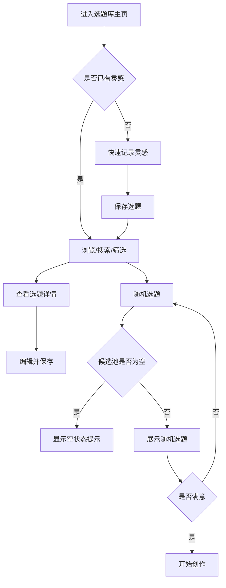

# PRD：创作者选题灵感库

## 1. 背景与调研结论

内容创作者普遍面临“灵感散落、难找回、发布前不知道写什么”的问题。本产品定位为一个轻量、开箱即用的桌面 Web 选题灵感库，帮助通用多平台创作者集中记录、整理、筛选和复用选题。

竞品调研采用文字调研方式，未生成截图视觉证据：

| 竞品 | 可借鉴点 | 不采用点 |
|---|---|---|
| 飞书多维表格 | 标签/状态/优先级结构化字段，组合筛选 | 表格感过重，学习成本高 |
| Notion | 卡片列表 + 详情页，快速录入与详情分离 | 配置过重，缺少随机选题 |
| Trello | 状态看板，进度感清晰 | 缺少优先级体系，选题多时混乱 |

选定方向：融合方案。默认卡片列表 + 快速录入 + 详情抽屉 + 组合筛选 + 状态看板切换 + 随机选题。

## 2. 页面清单与跳转逻辑

| 序号 | 页面名称 | 页面类型 | 可见角色 | 入口来源 | 跳转去向 |
|---|---|---|---|---|---|
| P01 | 选题库主页 | 列表/卡片 + 看板视图 | 创作者本人 | 打开应用直达 | P02、P03、P04 |
| P02 | 选题详情抽屉 | 详情页 | 创作者本人 | 点击选题卡片 | 返回 P01 |
| P03 | 快速录入弹窗 | 表单页 | 创作者本人 | P01“快速记录”按钮 | 返回 P01 |
| P04 | 标签管理页 | 管理/设置页 | 创作者本人 | 顶部导航“标签管理” | 返回 P01 |

```text
P01 选题库主页
 ├─ 点击选题卡片 → P02 选题详情抽屉
 ├─ 点击“快速记录” → P03 快速录入弹窗
 └─ 点击“标签管理” → P04 标签管理页
P02 / P03 / P04 → 返回 P01
```

全局布局：桌面 Web 单用户，无登录和复杂侧边栏。顶部栏包含应用名称、搜索框、筛选入口、视图切换、快速记录、随机选题。

## 3. 主要功能定义与分析

### P01 选题库主页

| 功能编号 | 功能名称 | 一句话描述 | 完成标准 |
|---|---|---|---|
| F-01-01 | 快速记录入口 | 顶部按钮打开录入弹窗 | 点击后弹出 P03 |
| F-01-02 | 选题卡片列表 | 展示标题、标签、状态、优先级、更新时间 | 进入页面可见选题列表，空数据有引导 |
| F-01-03 | 视图切换 | 列表/看板切换 | 点击后展示形式立即变化 |
| F-01-04 | 关键词搜索 | 按标题、内容、标签搜索 | 输入后结果实时更新 |
| F-01-05 | 组合筛选 | 按标签、状态、优先级、更新时间筛选 | 条件变化后列表同步刷新 |
| F-01-06 | 排序 | 按优先级、创建时间、更新时间排序 | 选择后列表顺序变化 |
| F-01-07 | 随机选题 | 在当前筛选结果中随机抽一条 | 弹窗展示选中选题，支持换一个 |
| F-01-08 | 状态快速修改 | 看板拖动或快捷菜单改状态 | 修改后卡片位置/标识立即更新 |
| F-01-09 | 删除选题 | 单条删除 | 确认后选题从列表消失 |

P01 功能边界：不包含批量操作、日历视图、数据分析；不做全文分词搜索；不做智能推荐。

### P02 选题详情抽屉

| 功能编号 | 功能名称 | 一句话描述 | 完成标准 |
|---|---|---|---|
| F-02-01 | 查看详情 | 展示全部字段 | 点击卡片后抽屉展示完整信息 |
| F-02-02 | 编辑选题 | 修改标题、内容、备注、标签、来源、状态、优先级 | 保存后列表与详情同步更新 |
| F-02-03 | 删除选题 | 在当前详情抽屉删除 | 确认后关闭抽屉并刷新列表 |

P02 功能边界：不包含历史版本、附件、图片、撤销/回收站。

### P03 快速录入弹窗

| 功能编号 | 功能名称 | 一句话描述 | 完成标准 |
|---|---|---|---|
| F-03-01 | 新建选题 | 填写标题、内容、标签、来源、状态、优先级 | 保存后新选题出现在列表顶部 |
| F-03-02 | 输入校验 | 标题必填，其余可选 | 缺失标题时给出明确提示 |
| F-03-03 | 内联新建标签 | 录入时快速新建标签 | 保存后新标签可选并同步到标签库 |

P03 功能边界：不包含批量导入、重复检测、敏感词检测。

### P04 标签管理页

| 功能编号 | 功能名称 | 一句话描述 | 完成标准 |
|---|---|---|---|
| F-04-01 | 标签列表 | 展示名称、颜色、使用次数 | 进入页面即可看到全部标签 |
| F-04-02 | 新建标签 | 输入名称并选择颜色 | 保存后标签出现在列表 |
| F-04-03 | 编辑标签 | 修改名称或颜色 | 修改后相关选题同步显示新标签 |
| F-04-04 | 删除标签 | 删除指定标签 | 确认后标签从列表和相关选题移除 |

P04 功能边界：不包含标签排序、层级标签、标签合并、批量导入。

## 4. Mission、Persona、版本规划与业务规则

### Mission

为通用多平台内容创作者提供一个轻量、开箱即用的选题灵感库，减少灵感流失，让“今天写什么”不再靠临时拍脑袋。

### Persona

- 昵称：小夏
- 身份：同时运营小红书、公众号、B站/抖音的多平台创作者
- 目标：随手记录灵感，快速整理标签/状态/优先级，发布前能迅速选出一个可执行选题
- 痛点：灵感散落难找回；选题没有状态和优先级；发布前决策成本高
- 使用场景：桌面 Web，随时记录 + 发布前选题规划

### 版本规划

#### V1 / MVP

| 页面 | 包含功能 | 排除功能 | 理由 |
|---|---|---|---|
| P01 | F-01-01 至 F-01-09 | 批量操作、日历视图、数据分析 | 先验证核心记录与筛选流程 |
| P02 | F-02-01 至 F-02-03 | 历史版本、附件、图片 | 非核心记录需求 |
| P03 | F-03-01 至 F-03-03 | 批量导入、重复检测 | 保持录入轻量 |
| P04 | F-04-01 至 F-04-04 | 标签合并、层级标签 | 第一版标签体系保持扁平 |

#### V2+

| 功能 | 预计版本 | 延后理由 |
|---|---|---|
| 内容日历/发布排期 | V2 | 与选题库互补，但不是第一版最小闭环 |
| 批量导入/导出 | V2 | 需要定义导入格式与冲突策略 |
| 回收站/撤销删除 | V2 | 降低误删风险，MVP 用确认弹窗替代 |
| 账号与云同步 | V2 | 涉及后端、认证和数据迁移 |
| AI 扩写/标题生成/选题推荐/重复检测 | V2 | 外部依赖，需后续确认模型与 Key |
| 附件与图片 | V2 | 存储方案与文件管理成本较高 |
| 发布复盘数据看板 | V2+ | 依赖多平台数据接入 |

### 关键业务规则

- 选题状态：`待验证 → 创作中 → 已发布`，另有终止态 `已放弃`。
- 选题优先级：`高、中、低`，默认 `中`。
- 随机选题：只从当前筛选结果中抽取，默认排除 `已发布、已放弃`；MVP 不做权重推荐。
- 新建选题：标题必填，标签/来源/备注可选，状态默认 `待验证`。
- 标签：名称唯一、颜色可自定义；删除标签后从相关选题中移除。
- 数据：第一版本地浏览器存储，无账号、无后端；浏览器数据清除会清空选题库。

## 5. 关键功能实现思路

本项目无支付、AI、实时通信、工作流编排等复杂业务链路。关键实现点仅两项：

### 随机选题

- 触发场景：用户在 P01 点击“随机选题”。
- 实现思路：基于当前筛选结果构建候选池，过滤 `已发布、已放弃` 状态后等概率随机抽取。
- 技术选型：前端内存筛选，无后端。

### 本地持久化

- 触发场景：新增、编辑、删除选题或标签后。
- 实现思路：使用浏览器 `localStorage` 保存结构化 JSON。
- 技术选型：React + TypeScript + Vite，本地状态层与持久化层分离，便于未来替换为后端 API。

## 6. 数据契约确认清单

### A5-1 业务数据契约

#### 选题 Topic

- [ ] `id`：string，唯一标识
- [ ] `title`：string，必填
- [ ] `content`：string，可选，选题说明或正文草稿
- [ ] `notes`：string，可选，备注
- [ ] `source`：string，可选，灵感来源
- [ ] `tag_ids`：string[]，关联标签
- [ ] `status`：枚举 `pending | working | published | abandoned`
- [ ] `priority`：枚举 `high | medium | low`
- [ ] `created_at`：ISO datetime
- [ ] `updated_at`：ISO datetime

#### 标签 Tag

- [ ] `id`：string，唯一标识
- [ ] `name`：string，必填且唯一
- [ ] `color`：string，十六进制色值
- [ ] `created_at`：ISO datetime
- [ ] `usage_count`：计算字段，由关联选题数量得出

#### 状态枚举

- [ ] `待验证` → `pending`
- [ ] `创作中` → `working`
- [ ] `已发布` → `published`
- [ ] `已放弃` → `abandoned`

#### 优先级枚举

- [ ] `高` → `high`
- [ ] `中` → `medium`
- [ ] `低` → `low`

### A5-2 接口响应格式契约

即使 V1 为本地存储，前端服务层统一使用以下响应结构，便于后续接入后端：

- [ ] 成功响应：`{"code": 200, "message": "success", "data": { ... }}`
- [ ] 错误响应：`{"code": <错误码>, "message": "<错误描述>", "data": null}`
- [ ] 分页响应：`{"code": 200, "message": "success", "data": {"items": [...], "total": 100, "page": 1, "page_size": 20}}`
- [ ] HTTP 状态码：200 成功 / 400 参数错误 / 401 未认证 / 403 无权限 / 404 不存在 / 500 服务器错误

## 7. 外部依赖与配置草稿

| 依赖 | 用途 | 关键配置字段 | Key/账号来源 | 存放位置 | 缺失时策略 | 状态 |
|---|---|---|---|---|---|---|
| LLM | 无 | 无 | 无 | 无 | 无 | 不涉及 |
| Embedding | 无 | 无 | 无 | 无 | 无 | 不涉及 |
| Rerank | 无 | 无 | 无 | 无 | 无 | 不涉及 |
| 第三方 API / 数据源 | 无 | 无 | 无 | 无 | 无 | 不涉及 |
| 支付 / 结算 | 无 | 无 | 无 | 无 | 无 | 不涉及 |
| 短信 / 邮件 / 推送 | 无 | 无 | 无 | 无 | 无 | 不涉及 |
| 对象存储 / 文件服务 | 无 | 无 | 无 | 无 | 无 | 不涉及 |
| 第三方登录 / SSO / OAuth | 无 | 无 | 无 | 无 | 无 | 不涉及 |
| 地图 / 定位 / 实名 / 风控 | 无 | 无 | 无 | 无 | 无 | 不涉及 |

结论：V1 无任何外部服务依赖，数据仅存于浏览器本地。

## 8. 路线图（终版）

| 版本 | 范围 | 核心能力 |
|---|---|---|
| V1 / MVP | P01-P04 全部页面 | 灵感录入、标签、状态、优先级、搜索筛选、随机选题，本地存储 |
| V2 | 日历排期、云同步、批量导入导出、回收站 | 多端同步与内容排期 |
| V2+ | AI 扩写/推荐、附件、数据看板 | 智能辅助与发布复盘 |

## 9. 技术架构蓝图

- 架构：V1 为纯前端单页应用，无后端服务。
- 前端：React + TypeScript + Vite + Ant Design。
- 状态管理：Zustand，负责选题、标签、筛选条件与 UI 状态。
- 数据持久化：浏览器 `localStorage`，通过独立持久化适配层访问，便于后续替换为后端 API。
- 服务层：统一 `code/message/data` 响应结构，前端服务方法不直接操作存储。
- 部署：静态站点托管（Nginx / Vercel / Netlify 等），无服务端运行依赖。

分层关系：

```text
UI Components
  -> Pages
    -> Store (Zustand)
      -> Service Layer
        -> Persistence Adapter
          -> localStorage
```

## 10. 原型说明

- Pencil 源文件：`docs/prototypes/creator-topic-library.pen`
- 页面预览：
  - `docs/prototypes/01-选题库主页.png`
  - `docs/prototypes/02-选题详情抽屉.png`
  - `docs/prototypes/03-快速录入弹窗.png`
  - `docs/prototypes/04-标签管理页.png`
- 界面关系：P01 为默认入口；P02/P03 由 P01 触发；P04 由顶部导航进入后返回 P01。

## 11. 核心流程图



异常分支：当删除标签时，需二次确认；删除后自动从关联选题移除该标签。当浏览器清空本地数据时，选题库回到初始空状态。

## 12. 组件交互说明

- `TopicCard`：展示选题摘要与核心状态，触发详情抽屉。
- `TopicFilterBar`：组合标签、状态、优先级、时间条件，驱动列表刷新。
- `TopicKanban`：按状态分列展示选题，支持状态调整。
- `QuickCreateModal`：快速录入并保存选题。
- `TopicDetailDrawer`：查看/编辑/删除选题。
- `TagManager`：标签增删改查，删除时联动更新选题。
- `RandomPicker`：基于当前筛选结果和排除规则随机抽取选题。

## 13. 技术选型与风险

| 技术点 | 选型 | 风险 | 缓解 |
|---|---|---|---|
| 前端框架 | React + TypeScript + Vite | 团队需熟悉 TS 类型 | 严格 type-check，MVP 范围小 |
| 组件库 | Ant Design | 默认视觉偏业务，与暖纸风有差异 | 按 Design Spec 覆盖 token |
| 状态管理 | Zustand | 本地状态增长后需规范 | 按页面与领域拆分 store |
| 持久化 | localStorage | 清缓存或换设备导致数据丢失 | V2 增加导出与云同步；服务层预留接口 |
| 无后端 | 纯前端 | 无法多设备同步 | V1 明确本地优先，V2 接 FastAPI |
