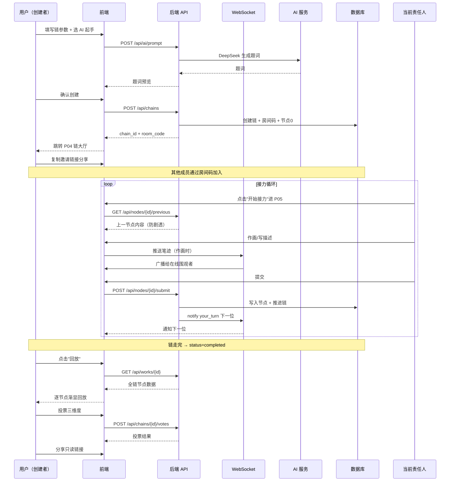
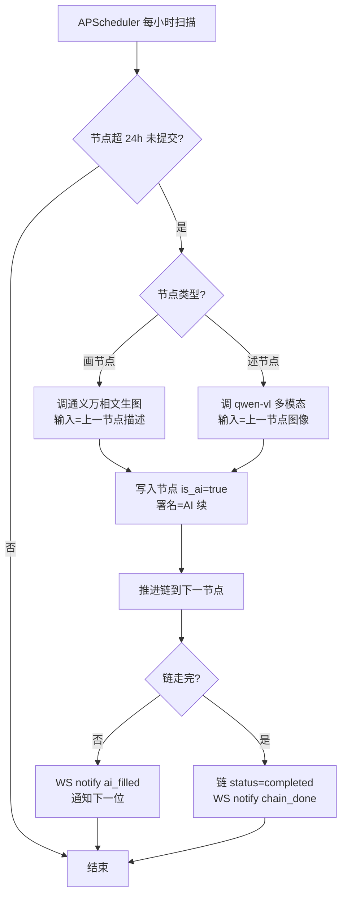
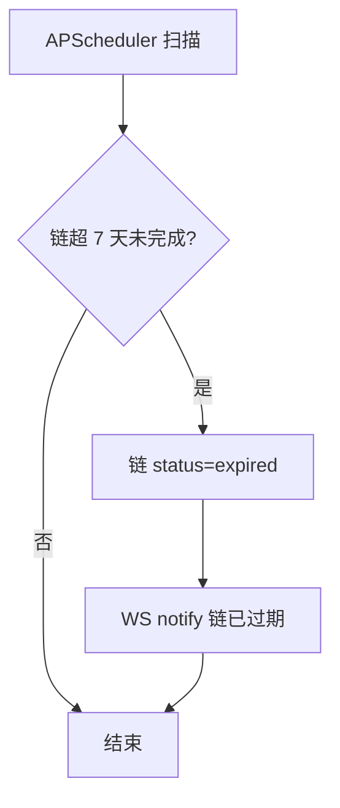

# 画意接龙 PRD

> 状态：阶段 C 定稿
> 最后更新：2026-08-19
> active_project_path = Projects_Repo/draw-telephone/

---

## 1. 背景与调研结论

### 1.1 项目目标

做一个异步绘画接力的多人共创平台「画意接龙」。核心乐趣是"跑偏"——A 画图 → B 文字描述 → C 照描述画 → … 一条链走完，回放整条链看一幅画如何演变。实时围观 + 过程回放让共创过程本身成为乐趣。

### 1.2 目标用户

创意/设计爱好者。对视觉表达有兴趣、享受"误读"带来的惊喜的人群。

### 1.3 使用场景

异步接力：一人画一笔/写一句，随时接力，不必同时在线。在线时可实时围观别人作画过程；提交后通知下一位。

### 1.4 核心问题

- 让"多人共创一幅画"这件事在异步、不必凑时间的前提下成立
- 让"跑偏"（误读带来的演变）成为可回放、可分享、可投票的乐趣，而非缺陷
- 防止链因某人弃接而"死掉"

### 1.5 调研结论（阶段 R）

> ⚠️ 视觉证据状态：当前网络环境拦截了竞品官网（Gartic Phone、Drawception）和搜索引擎结果页，无法自动截图或抓取实时内容。以下分析基于对这类产品的已有认知，**未实时验证**，视觉证据暂缺。B1 阶段如能提供截图会补入 `visual-research.md`；否则用默认设计基底继续。

三个竞品覆盖三个范式：
- **Gartic Phone** = 同步传话接力 + 强回放（最贴玩法，但同步）
- **Drawception** = 异步接力 + 公开画廊（最贴异步，但视觉弱、无实时围观）
- **你画我猜**（国内）= 同步画猜（国内社交参考，但玩法不同）

**选定方案：融合** = Gartic Phone 的传话接力玩法 + Drawception 的异步/画廊机制 + 实时围观 + 设计爱好者审美 + AI 起手/补位。这个组合在三个竞品中都没有被完整覆盖，定位有差异化空间。

### 1.6 关键产品结论

1. 异步 + 实时围观是核心差异化，需 WebSocket 推送作画过程
2. 回放体验是乐趣落点，逐节点渐显动画是重点
3. 公开广场 + 邀请制双模式，兼顾社交发现与私密
4. 视觉需偏设计爱好者审美（区别于竞品的卡通/简陋风），B1 阶段定调

---

## 2. 页面清单与跳转逻辑（A1）

### 2.1 页面清单

| 序号 | 页面名称 | 页面类型 | 可见角色 | 入口来源 | 跳转去向 |
|------|---------|---------|---------|---------|---------|
| P01 | 首页/广场 | 列表页 | 所有人（含游客） | 直接访问 | P02 创建、P03 加入、P06 作品详情 |
| P02 | 创建链页 | 表单页 | 登录用户 | P01「创建」按钮 | P04 链大厅 |
| P03 | 加入链页 | 表单页 | 登录用户 | P01「加入」/邀请链接 | P04 链大厅 |
| P04 | 链大厅（房间页） | 仪表盘 | 房间成员 | P02/P03 创建或加入后 | P05 接力作画、P07 回放 |
| P05 | 接力作画/描述页 | 对话/创作页 | 当前节点责任人 | P04「轮到你了」 | P04（提交后返回大厅） |
| P06 | 作品详情页（只读作品页） | 详情页 | 所有人（含游客） | P01 广场卡片、P07 回放后、分享链接 | P01 |
| P07 | 整链回放页（含投票） | 详情页 | 房间成员 | P04 链完成后「回放」、P06「看回放」 | P06 作品页 |
| P08 | 个人主页 | 列表页 | 登录用户（自己）/他人浏览 | 顶部导航头像 | P06（点击作品） |
| P09 | 登录/注册页 | 表单页 | 未登录用户 | 顶部导航「登录」 | P01 |

> 设计决策（默认，可改）：
> - 创建/加入需登录，浏览广场和作品可游客访问（降低分享门槛）
> - P10 投票页合并进 P07 回放页（回放完直接投票，减少跳转）

### 2.2 页面跳转图

```text
P09 登录/注册 ──┐
               ↓
P01 首页/广场 ──创建──→ P02 创建链 ──┐
        │      └──加入/邀请链接──→ P03 加入链 ──┤
        │                                    ↓
        │                              P04 链大厅 ──轮到你──→ P05 接力作画/描述 ──提交──┐
        │                                    ↑              ←──────────────────────────┘
        │                                    │
        │                                    链完成
        │                                    ↓
        │                              P07 整链回放 ──投票──→ (P07 内投票环节) ──结果──┐
        │                                    ↑                  ←──────────────────────┘
        │                                    │
        └──点击作品──→ P06 作品详情(只读) ←──分享链接(外部)
                            ↑
                       P08 个人主页 ──点击作品──→ P06
```

### 2.3 全局布局结构

- **顶部导航栏（全局）**：左=Logo「画意接龙」；中=导航（广场 / 我的）；右=通知铃铛（轮到你了/链完成）、用户头像→下拉（个人主页/登出）
- **无统一侧边栏**：创作类页面（P05）需全屏画布，不套侧边栏
- **公共模块分布**：通知铃铛在顶部导航全局可见；用户信息在头像下拉

---

## 3. 主要功能定义与分析（A2，按页面组织）

### 页面：P01 首页/广场

#### 功能清单

| 功能编号 | 功能名称 | 一句话描述 | 用户可感知的完成标准 |
|---------|---------|-----------|-------------------|
| F-01-01 | 广场作品流 | 展示公开已完成链的作品卡片 | 用户进入首页即看到作品卡片瀑布流，可滚动加载 |
| F-01-02 | 创建链入口 | 登录用户发起一条新链 | 登录用户看到「创建」按钮，点击进入 P02 |
| F-01-03 | 加入链入口 | 通过房间码加入进行中的链 | 用户看到「加入」入口，输入码后进入 P03 |
| F-01-04 | 筛选排序 | 按最新/最跑偏/最多点赞浏览广场 | 用户切换筛选条件，列表随之刷新 |
| F-01-05 | 登录入口 | 游客引导登录 | 游客看到「登录」按钮，点击进入 P09 |

#### 功能边界

| 功能编号 | 包含 | 不包含 |
|---------|------|--------|
| F-01-01 | 已完成公开链卡片、缩略图、链标题、作者数 | 不展示进行中链、不展示私密链 |
| F-01-02 | 登录用户可创建 | 游客不可创建，需先登录 |
| F-01-04 | 最新/最跑偏/最多点赞三档 | 不支持标签搜索、不支持时间范围筛选（V2） |

#### 与其他页面的关联
- 点击作品卡片 → P06 作品详情
- 点击「创建」→ P02；点击「加入」→ P03；点击「登录」→ P09

---

### 页面：P02 创建链页

#### 功能清单

| 功能编号 | 功能名称 | 一句话描述 | 用户可感知的完成标准 |
|---------|---------|-----------|-------------------|
| F-02-01 | 链参数设置 | 设定链长、标题、公开性 | 用户填完参数表单，可提交 |
| F-02-02 | 起手题来源 | 自己写题 or AI 生成种子题 | 用户选择来源，AI 生成时看到题词预览 |
| F-02-03 | 创建并生成房间码 | 提交后生成房间码与邀请链接 | 用户提交后看到6位房间码+可复制链接，跳转 P04 |
| F-02-04 | 首节点指派 | 创建者默认承接第一节点 | 创建者进入 P04 后看到「轮到你了」 |

#### 功能边界

| 功能编号 | 包含 | 不包含 |
|---------|------|--------|
| F-02-01 | 链长4-10可选默认6、标题可选、公开性(邀请制/公开广场) | 不支持自定义节点类型序列（固定画-述交替） |
| F-02-02 | 手动题词、AI 生成（DeepSeek） | 不支持上传图片作起手题（V2） |

#### 与其他页面的关联
- 提交成功 → P04 链大厅

---

### 页面：P03 加入链页

#### 功能清单

| 功能编号 | 功能名称 | 一句话描述 | 用户可感知的完成标准 |
|---------|---------|-----------|-------------------|
| F-03-01 | 房间码输入 | 输入6位码加入链 | 用户输入码，校验通过进入 P04 |
| F-03-02 | 邀请链接解析 | 从邀请链接带码直接加入 | 用户点链接，自动带码，确认后进入 P04 |

#### 功能边界

| 功能编号 | 包含 | 不包含 |
|---------|------|--------|
| F-03-01 | 6位码校验、链未满校验、链未过期校验 | 不支持扫码加入（V2） |

#### 与其他页面的关联
- 加入成功 → P04 链大厅

---

### 页面：P04 链大厅（房间页）

#### 功能清单

| 功能编号 | 功能名称 | 一句话描述 | 用户可感知的完成标准 |
|---------|---------|-----------|-------------------|
| F-04-01 | 链状态展示 | 展示链进度、当前节点、成员 | 用户看到进度条(第3/6节点)、当前谁在画、成员头像 |
| F-04-02 | 实时围观 | WebSocket 推送当前节点作画过程 | 在线成员看到当前作画者画布实时变化 |
| F-04-03 | 轮到你了入口 | 当前节点责任人进入接力 | 责任人看到高亮「开始接力」按钮，点击进 P05 |
| F-04-04 | 提交通知 | 节点提交后通知下一位 | 下一位收到站内通知+顶部铃铛红点 |
| F-04-05 | 链完成入口 | 链走完出现回放入口 | 链完成后成员看到「回放」按钮，点击进 P07 |
| F-04-06 | AI 补位倒计时 | 24h 未提交显示 AI 接手倒计时 | 成员看到当前节点「AI 将在 XX 小时后接手」 |

#### 功能边界

| 功能编号 | 包含 | 不包含 |
|---------|------|--------|
| F-04-02 | 实时围观作画笔迹推送 | 不支持围观者实时语音/弹幕（V2） |
| F-04-06 | 24h 倒计时展示 | 不支持手动触发 AI 补位（自动） |

#### 与其他页面的关联
- 「开始接力」→ P05；「回放」→ P07

---

### 页面：P05 接力作画/描述页

#### 功能清单

| 功能编号 | 功能名称 | 一句话描述 | 用户可感知的完成标准 |
|---------|---------|-----------|-------------------|
| F-05-01 | 上一节点展示 | 只展示上一节点内容防剧透 | 用户只看到上一节点（题词或画），看不到后续 |
| F-05-02 | 画布涂鸦（绘画节点） | 提供画笔工具作画 | 用户能用笔刷/颜色/粗细/橡皮/撤销作画，画完提交 |
| F-05-03 | 文字描述输入（描述节点） | 看画写描述 | 用户看到上一幅画，输入≤30字描述，提交 |
| F-05-04 | 提交接力 | 提交当前节点 | 用户提交后返回 P04，看到下一节点解锁 |
| F-05-05 | 实时围观推送 | 作画过程实时推送 | 围观者在 P04 看到该用户实时笔迹 |

#### 功能边界

| 功能编号 | 包含 | 不包含 |
|---------|------|--------|
| F-05-02 | 笔刷/颜色/粗细/橡皮/撤销/重做、固定画布尺寸、导出PNG | 不支持图层、不支持导入图片、不支持动效笔刷（V2） |
| F-05-03 | 纯文本≤30字 | 不支持表情/图片描述 |

#### 与其他页面的关联
- 提交 → P04

---

### 页面：P06 作品详情页（只读作品页）

#### 功能清单

| 功能编号 | 功能名称 | 一句话描述 | 用户可感知的完成标准 |
|---------|---------|-----------|-------------------|
| F-06-01 | 整链展示 | 只读展示完整链 | 用户看到 A画→B述→C画→… 全链，每节点带作者署名/AI续标注 |
| F-06-02 | 导出整链长图 | 导出拼接长图 | 用户点击导出，下载整链 PNG 长图 |
| F-06-03 | 分享链接 | 生成只读分享链接 | 用户复制链接，他人可游客访问该作品页 |
| F-06-04 | 点赞 | 游客可点赞 | 用户点点赞按钮，计数+1 |
| F-06-05 | 回放入口 | 进回放页 | 用户点「看回放」进 P07 |

#### 功能边界

| 功能编号 | 包含 | 不包含 |
|---------|------|--------|
| F-06-01 | 全链只读、署名、AI续标注 | 不支持在详情页编辑 |
| F-06-04 | 游客可点赞（按IP/设备去重） | 不支持评论（V2） |

#### 与其他页面的关联
- 「看回放」→ P07；返回 → P01 或来源页

---

### 页面：P07 整链回放页（含投票）

#### 功能清单

| 功能编号 | 功能名称 | 一句话描述 | 用户可感知的完成标准 |
|---------|---------|-----------|-------------------|
| F-07-01 | 逐节点渐显回放 | 动画逐节点渐显 | 用户看到节点逐个动画出现，带署名/AI续标注 |
| F-07-02 | 回放控制 | 暂停/继续/重播 | 用户可控制回放节奏 |
| F-07-03 | 投票 | 回放后投票三维度 | 用户看到投票面板，三维度各投一票（最跑偏/最佳画/最佳描述） |
| F-07-04 | 投票结果展示 | 展示投票结果 | 用户提交投票后看到结果统计 |

#### 功能边界

| 功能编号 | 包含 | 不包含 |
|---------|------|--------|
| F-07-03 | 房间内成员投票、三维度各一票 | 不支持游客投票、不支持多轮投票 |
| F-07-04 | 结果统计展示 | 不支持奖品/积分体系（V2） |

#### 与其他页面的关联
- 回放/投票完成 → 可转 P06 分享，或返回 P04

---

### 页面：P08 个人主页

#### 功能清单

| 功能编号 | 功能名称 | 一句话描述 | 用户可感知的完成标准 |
|---------|---------|-----------|-------------------|
| F-08-01 | 我的作品 | 展示参与/创建的链作品 | 用户看到自己参与过的作品卡片列表 |
| F-08-02 | 链状态分类 | 进行中/已完成分类 | 用户可切换查看进行中或已完成 |
| F-08-03 | 个人设置 | 昵称/头像 | 用户可修改昵称头像 |

#### 功能边界

| 功能编号 | 包含 | 不包含 |
|---------|------|--------|
| F-08-03 | 昵称、头像修改 | 不支持绑定邮箱/手机（V2） |

#### 与其他页面的关联
- 点击作品 → P06

---

### 页面：P09 登录/注册页

#### 功能清单

| 功能编号 | 功能名称 | 一句话描述 | 用户可感知的完成标准 |
|---------|---------|-----------|-------------------|
| F-09-01 | 账号注册 | 用户名+密码注册 | 用户填表注册成功，自动登录跳 P01 |
| F-09-02 | 账号登录 | 用户名+密码登录 | 用户登录后跳回来源页或 P01 |
| F-09-03 | 游客浏览提示 | 提示可游客浏览 | 用户看到「先逛逛」入口，回 P01 |

#### 功能边界

| 功能编号 | 包含 | 不包含 |
|---------|------|--------|
| F-09-01 | 用户名+密码注册 | 不支持第三方登录、不支持邮箱验证（V2） |

#### 与其他页面的关联
- 登录/注册成功 → P01 或来源页；「先逛逛」→ P01

---

## 4. Mission、Persona、版本规划（A3）

### 4.1 Mission

让"多人共创一幅画"在异步、不必凑时间的前提下成立，把"误读带来的跑偏"变成可回放、可分享、可投票的乐趣，而非缺陷。

### 4.2 Persona

- **创意/设计爱好者**：对视觉表达有兴趣，享受"误读"带来的惊喜，不追求画技，享受过程而非结果
- 使用节奏：碎片时间随时接力，不希望被同步限时压迫

### 4.3 关键业务规则（Business Rules）

| 规则 | 说明 |
|------|------|
| BR-01 节点可见性 | 任何节点只能看到上一节点内容，不得看到后续，否则破坏跑偏 |
| BR-02 节点类型序列 | 固定画-述交替，起手为画（AI 起手生成文字题词 → 第一节点为画，照题词画） |
| BR-03 链长度 | 创建者设定 4-10 节点，默认 6 |
| BR-04 房间有效期 | 链 7 天有效，超期未完成自动关闭 |
| BR-05 AI 补位触发 | 节点 24h 未提交，AI 自动接手续链，产出标注"AI 续" |
| BR-06 AI 起手 | 创建者不提供题词时，AI 生成种子题 |
| BR-07 公开性 | 邀请制（房间码加入）+ 公开广场（已完成链可被浏览） |
| BR-08 投票 | 链完成后房间内成员投票，三维度各一票（最跑偏/最佳画/最佳描述） |
| BR-09 游客权限 | 游客可浏览广场和作品、可点赞（IP/设备去重），不可创建/加入/投票 |
| BR-10 节点署名 | 每节点带作者署名，AI 补位标注"AI 续"不冒充真人 |

### 4.4 版本规划

#### V1 / MVP

| 页面 | 包含功能 | 排除功能 | 理由 |
|------|---------|---------|------|
| P01 首页/广场 | F-01-01 广场流、F-01-02 创建入口、F-01-03 加入入口、F-01-05 登录入口 | F-01-04 筛选排序 | 筛选需排序逻辑+索引，MVP 先按最新单一排序 |
| P02 创建链页 | F-02-01 参数设置、F-02-02 起手题(手动+AI)、F-02-03 生成房间码、F-02-04 首节点指派 | — | 核心入口，必须 MVP |
| P03 加入链页 | F-03-01 房间码输入、F-03-02 邀请链接解析 | — | 核心入口，必须 MVP |
| P04 链大厅 | F-04-01 状态展示、F-04-02 实时围观、F-04-03 轮到你入口、F-04-04 提交通知、F-04-05 链完成入口、F-04-06 AI补位倒计时 | — | 核心协作枢纽，必须 MVP |
| P05 接力作画/描述页 | F-05-01 上一节点展示、F-05-02 画布涂鸦、F-05-03 文字描述、F-05-04 提交、F-05-05 实时围观推送 | — | 核心玩法，必须 MVP |
| P06 作品详情页 | F-06-01 整链展示、F-06-03 分享链接、F-06-05 回放入口 | F-06-02 导出长图、F-06-04 点赞 | 导出需拼接渲染，点赞需去重逻辑，V2 再做 |
| P07 整链回放页 | F-07-01 逐节点渐显回放、F-07-03 投票、F-07-04 结果展示 | F-07-02 回放控制(暂停/重播) | 控制需播放器状态机，MVP 先自动渐显 |
| P08 个人主页 | F-08-01 我的作品 | F-08-02 状态分类、F-08-03 个人设置 | 分类筛选和设置非核心，V2 |
| P09 登录/注册页 | F-09-01 注册、F-09-02 登录、F-09-03 游客提示 | — | 必须 MVP |

> 设计决策（默认，可改）：MVP 全含 9 页 + WebSocket 实时围观 + AI 起手/补位真实生效（不降级）。

#### V2+

| 功能 | 预计版本 | 延后理由 |
|------|---------|---------|
| F-01-04 广场筛选排序 | V1.1 | 需排序索引+多条件，MVP 单排序够用 |
| F-06-02 导出整链长图 | V1.1 | 需 canvas 拼接渲染+服务端导出，复杂 |
| F-06-04 游客点赞 | V1.2 | 需 IP/设备去重逻辑，非核心 |
| F-07-02 回放控制(暂停/重播) | V1.2 | 需播放器状态机，MVP 自动渐显够用 |
| F-08-02 链状态分类、F-08-03 个人设置 | V1.3 | 非核心体验 |
| F-09-01 第三方登录/邮箱验证 | V2 | 需开放平台审核+邮件服务，阻塞 |
| F-05-02 图层/导入图片/动效笔刷 | V2 | 画布增强，非核心玩法 |
| F-04-02 围观语音/弹幕 | V2 | 需音视频通道，重 |
| 评论体系 | V2 | 社区互动，非核心 |

---

## 5. 复杂功能业务链路 + 关键实现思路（A4）

### 关键链路 1：实时围观（WebSocket 实时推送作画过程）

- **触发场景**：当前节点责任人在 P05 作画时，P04 在线成员实时看到笔迹
- **实现思路**：前端 canvas 捕获笔迹事件（pointerdown/move/up + 坐标+颜色+粗细）→ WebSocket 发后端 → 后端广播给同房间在线成员 → 成员前端 canvas 重绘笔迹
- **关键技术选型**：
  - 传输：**笔迹事件流**（坐标点序列）而非整帧截图。带宽低、实时性好
  - 协议：FastAPI WebSocket（与后端同栈，复用 PyCore）
  - 节流：前端按时间/距离节流采样，避免高频推送
- **设计决策（默认，可改）**：
  - 不存笔迹过程回放，只存最终图（离线者提交后看最终图即可）
  - MVP 房间人数预期小（<20），单机 WebSocket 够用，V2 再考虑水平扩展

### 关键链路 2：AI 起手（种子题生成）

- **触发场景**：创建链时用户选"AI 生成题词"
- **实现思路**：用户点"AI 生成"→ 后端调 DeepSeek → 生成有趣、可被多种方式误读的题词 → 返回前端预览 → 用户可重新生成或采用 → 作为链起手题
- **关键技术选型**：
  - 文本模型：DeepSeek（用户提供 Key）
  - 提示词方向：生成"具象但开放"的题词（如"戴帽子的猫"而非"猫"），易被误读
  - 输出：单条文本题词，限 20 字内
- **设计决策（默认，可改）**：一次生成 1 条，用户可重新生成；题词不分类

### 关键链路 3：AI 补位（弃接续链）

- **触发场景**：某节点 24h 未提交
- **实现思路**：后端定时任务扫描超时节点 → 判断节点类型（画/述）→ 画节点调通义万相生成图、述节点调通义万相多模态看图生成描述 → 写入节点，标注"AI 续" → 推进链 → 通知下一位
- **关键技术选型**：
  - 调度：APScheduler 或 FastAPI 后台任务，每小时扫描一次
  - 画节点：通义万相文生图，输入=上一节点描述，输出=PNG
  - 述节点：通义万相/qwen-vl 多模态看图 → 生成描述
- **设计决策（默认，可改）**：
  - 述节点补位用通义万相同源多模态看图生成描述
  - AI 补位画图约束为简笔画风格贴近人类涂鸦
  - 每小时扫描一次，24h 触发

### 关键链路 4：整链回放（逐节点渐显）

- **触发场景**：链完成后用户点"回放"
- **实现思路**：前端按节点顺序逐个动画渐显（画节点淡入图像、述节点淡入文字）→ 带署名/AI续标注 → 自动播放到底
- **关键技术选型**：
  - 纯前端动画（CSS/framer-motion），无需后端参与
  - 数据：链完成后一次性拉取全链节点数据（MVP 不做流式）
- **设计决策（默认，可改）**：每节点 2 秒间隔（MVP 固定，V2 加控制）；无背景音乐（避免版权问题）

---

## 6. 数据契约确认清单（A5）

> 数据契约不跟随 V1/V2 变化，即使只开发部分功能也要完整设计。

### 6.1 业务数据契约（A5-1）

#### 用户体系
- [x] user_id（uuid）、用户名（string，3-20字符，唯一）、密码哈希（bcrypt）、昵称（string）、头像URL、注册时间（datetime）、角色（枚举：普通用户/管理员）
- [x] 游客标识：device_id 或 IP 哈希，用于点赞去重

#### 链（Chain）体系
- [x] chain_id（uuid）、标题（string，可选）、链长（int，4-10，默认6）、节点类型序列（固定画-述交替，起手为画）
- [x] 起手题来源（枚举：手动/AI）、起手题词（string，≤20字）
- [x] 公开性（枚举：邀请制/公开广场）、房间码（6位，大写字母+数字，唯一）
- [x] 状态（枚举：进行中/已完成/已关闭/已过期）、创建者user_id、创建时间、完成时间、过期时间（创建+7天）

#### 节点（Node）体系
- [x] node_id（uuid）、chain_id、序号（int，从0）、节点类型（枚举：画/述）
- [x] 责任人user_id（AI补位时为null）、内容类型（枚举：图像/文本）
- [x] 内容（图像URL 或 文本≤30字）、提交时间、状态（枚举：待接/进行中/已提交/AI续/超时）
- [x] 是否AI补位（bool）、作者署名（string，AI续时显示"AI 续"）
- [x] 上一节点可见性约束：节点只能访问上一节点内容（BR-01）

#### 投票体系
- [x] vote_id（uuid）、chain_id、投票人user_id、维度（枚举：最跑偏/最佳画/最佳描述）、目标node_id
- [x] 约束：每人每维度一票、仅房间内成员可投（BR-08）

#### 作品/分享体系
- [x] 作品页=已完成链的只读视图，复用chain_id
- [x] 点赞（like_id、chain_id、device_id/IP哈希、时间）——V1.2，但契约先定
- [x] 导出长图：按需生成，不持久化（V1.1）

#### 通知体系
- [x] notification_id（uuid）、user_id、类型（枚举：轮到你了/链完成/节点提交）、chain_id、已读（bool）、时间

#### 权限角色
- [x] 管理员：全部权限（MVP暂不实现管理后台，但角色字段先留）
- [x] 普通用户：创建/加入链、接力、投票、管理自己作品
- [x] 游客：浏览广场、浏览作品、点赞（V1.2）

#### 状态流转
- [x] 链状态：进行中 → 已完成（走完） / 已关闭（手动） / 已过期（7天）
- [x] 节点状态：待接 → 进行中 → 已提交 / AI续（24h超时）

### 6.2 接口响应格式契约（A5-2，锁死）

#### 统一响应格式
- [x] 成功响应：`{"code": 200, "message": "success", "data": { ... }}`
- [x] 错误响应：`{"code": <错误码>, "message": "<错误描述>", "data": null}`
- [x] 分页响应：`{"code": 200, "data": {"items": [...], "total": 100, "page": 1, "page_size": 20}}`

#### HTTP 状态码约定
- [x] 200：成功 / 400：参数错误 / 401：未认证
- [x] 403：无权限 / 404：资源不存在 / 500：服务器内部错误

#### WebSocket 消息格式（本项目特有）
- [x] 笔迹事件：`{"type": "stroke", "chain_id": "...", "node_id": "...", "points": [{x,y,pressure}], "color": "#...", "size": N}`
- [x] 通知事件：`{"type": "notify", "event": "your_turn|chain_done|node_submitted", "chain_id": "..."}`
- [x] 围观订阅：`{"type": "subscribe", "chain_id": "..."}` / 服务端确认 `{"type": "subscribed"}`

---

## 7. 外部依赖与配置草稿（A5-3）

> 草稿已与用户确认（2026-08-19）。真实 Key/Secret 只进 `.env`，本表只记字段名与配置状态。

| 依赖 | 用途 | 关键配置字段 | Key/账号来源 | 存放位置 | 缺失时策略 | 状态 |
|------|------|-------------|-------------|----------|-----------|------|
| LLM 文本（DeepSeek） | AI 起手题词、AI 补位述节点描述 | `DEEPSEEK_API_KEY` `DEEPSEEK_BASE_URL` `DEEPSEEK_MODEL` | 用户提供 | backend/.env | Mock 降级 | ✅ 已确认 |
| 图像生成（通义万相） | AI 补位画节点续画 | `DASHSCOPE_API_KEY` `WANX_MODEL` | 用户提供（百炼Key） | backend/.env | Mock 占位图 | ✅ 已确认 |
| 多模态（通义万相/qwen-vl） | AI 补位述节点看图生成描述 | 复用 `DASHSCOPE_API_KEY` `QWEN_VL_MODEL` | 用户提供（同百炼Key） | backend/.env | Mock 降级 | ✅ 已确认 |
| 对象存储/文件服务 | 存画作PNG、导出长图 | 本地文件存储（MVP） | 无 | backend 本地目录 | 本地存储兜底 | ✅ 已确认（默认本地，V2 上 OSS） |
| WebSocket | 实时围观笔迹推送 | FastAPI WebSocket（无外部依赖） | 无 | — | 无 | ✅ 已确认 |
| 数据库 | 持久化用户/链/节点/投票 | `DATABASE_URL`（SQLite，MVP） | 无 | backend/.env | SQLite 兜底 | ✅ 已确认（默认 SQLite，V2 迁移） |
| 第三方登录/SSO | 微信等登录 | AppID/Secret、回调地址 | — | — | V2，MVP 用户名密码 | ✅ 已确认延后 |
| 支付/结算 | — | — | — | — | 无 | 不涉及 |
| 短信/邮件/推送 | 站内通知足够，MVP 无外部推送 | — | — | — | 无 | 不涉及 |
| 地图/定位/实名/风控 | — | — | — | — | 无 | 不涉及 |

### AI 默认配置

- AI 参与功能：① 起手种子题生成（文本）② 弃接补位续链（图像生成 + 文本描述）
- 模型/API 来源：DeepSeek（文本）+ 通义万相（图像+多模态），用户提供 Key
- 默认意图分类：起手 / 补位 两类
- 默认提示词方向：起手=生成有趣、可被多种方式误读的种子题；补位=模仿人类风格续画/续写，不剧透后续
- 默认知识来源：无外部知识库
- 默认输出格式：起手=文本题词；补位=PNG 图像 或 文本描述
- 默认自动执行边界：弃接超时 24h 后自动补位续链
- 必须用户确认场景：无
- 必须追问/拒绝/转人工场景：无
- 后续可替换项：模型供应商、提示词、超时时长均可后续调整

### 智能边界

- 可自动执行：弃接超时后 AI 自动补位续链（非高风险，无需用户确认）
- 不自动执行：正常接力节点必须由真人完成，AI 不替真人画/写
- 关键约束：AI 补位产出的节点会标注"AI 续"，回放时可见，不冒充真人

### 待办（进开发前必须完成）

- [ ] 用户提供 DeepSeek API Key，写入 backend/.env
- [ ] 用户提供百炼 API Key（通义万相），写入 backend/.env
- [ ] 确认 DeepSeek base_url / model 名称
- [ ] 确认通义万相 model 名称（文生图 + 多模态）

---

## 8. 路线图（版本规划终版）

> 本节为阶段 C 定稿，合并 A3 版本规划为完整路线图，是开发排期的唯一依据。

### 8.1 V1 / MVP（首发版本）

**目标**：跑通"创建→邀请→接力→AI 补位→回放→投票→分享"完整闭环，实时围观真实生效，AI 起手/补位真实生效（不降级）。

| 模块 | 包含功能 | 排除功能 | 理由 |
|------|---------|---------|------|
| P01 广场 | 广场流、创建入口、加入入口、登录入口 | 筛选排序 | MVP 单一最新排序够用 |
| P02 创建 | 参数设置、起手题(手动+AI)、生成房间码、首节点指派 | — | 核心入口 |
| P03 加入 | 房间码输入、邀请链接解析 | — | 核心入口 |
| P04 链大厅 | 状态展示、实时围观、轮到你入口、提交通知、链完成入口、AI 补位倒计时 | — | 核心协作枢纽 |
| P05 接力 | 上一节点展示、画布涂鸦、文字描述、提交、实时围观推送 | — | 核心玩法 |
| P06 作品详情 | 整链展示、分享链接、回放入口 | 导出长图、点赞 | 导出需拼接渲染，点赞需去重，延后 |
| P07 回放 | 逐节点渐显回放、投票、结果展示 | 回放控制 | MVP 自动渐显够用 |
| P08 个人主页 | 我的作品 | 状态分类、个人设置 | 非核心 |
| P09 登录注册 | 注册、登录、游客提示 | 第三方登录 | 需开放平台审核，阻塞 |
| 后端 | 认证、链创建、AI 起手、链查询加入、节点接力、图片上传、WebSocket、作品详情、投票、通知、个人、AI 补位定时任务 | — | 全量 MVP 后端 |

### 8.2 V1.1 ~ V2+（迭代版本）

| 功能 | 预计版本 | 延后理由 |
|------|---------|---------|
| 广场筛选排序（最新/最跑偏/最多点赞） | V1.1 | 需排序索引+多条件 |
| 导出整链长图 | V1.1 | 需 canvas 拼接渲染+服务端导出 |
| 游客点赞（IP/设备去重） | V1.2 | 需去重逻辑 |
| 回放控制（暂停/继续/重播） | V1.2 | 需播放器状态机 |
| 个人设置（昵称/头像） | V1.3 | 非核心体验 |
| 第三方登录/邮箱验证 | V2 | 需开放平台审核+邮件服务 |
| 画布增强（图层/导入图片/动效笔刷） | V2 | 非核心玩法 |
| 围观语音/弹幕 | V2 | 需音视频通道，重 |
| 评论体系 | V2 | 社区互动，非核心 |
| 对象存储迁移 OSS | V2 | MVP 本地存储兜底 |
| 数据库迁移（SQLite→PostgreSQL） | V2 | MVP SQLite 兜底 |

---

## 9. 技术架构蓝图

### 9.1 技术选型总览

| 层级 | 选型 | 说明 |
|------|------|------|
| 前端框架 | React 18 + TypeScript | 桌面 Web App |
| 前端构建 | Vite | 本地开发、代理、构建 |
| 前端路由 | react-router | 页面路由与鉴权守卫 |
| 前端状态 | Zustand | 登录态、全局 UI 状态 |
| 前端请求 | Axios | 统一 API 实例、拦截器、错误处理 |
| 前端组件库 | Ant Design | 桌面 Web |
| 画布 | canvas 2D | 涂鸦画布 + pointer 事件 + 笔迹序列化 |
| 实时通信 | 原生 WebSocket | 实时围观笔迹推送 |
| 动画 | framer-motion | 逐节点渐显回放 |
| 前端工程化 | ESLint + Prettier + type-check + build | 自动验收覆盖 |
| 后端框架 | Python 3.11 + FastAPI | 基于 pycore 脚手架 |
| 数据库 | SQLite（MVP） | V2 迁移 PostgreSQL |
| ORM | SQLAlchemy 2.x | pycore 集成 |
| 认证 | JWT（PyJWT） | access_token |
| 定时任务 | APScheduler | AI 补位 24h 扫描 |
| AI 文本 | DeepSeek | 起手题词生成 |
| AI 图像 | 通义万相（文生图） | AI 补位画节点 |
| AI 多模态 | 通义万相/qwen-vl | AI 补位述节点看图 |
| 文件存储 | 本地文件存储（MVP） | V2 上 OSS |
| 部署 | 单机部署（MVP） | V2 容器化 |

### 9.2 分层架构

```text
┌─────────────────────────────────────────────────┐
│  前端层（React + TS + Vite）                     │
│  ├─ 页面组件（P01~P09）                          │
│  ├─ 画布引擎（canvas 2D + 笔迹序列化）          │
│  ├─ WebSocket 客户端（实时围观）                 │
│  └─ service 层（Axios → REST / WS → 实时）       │
└──────────────────────┬──────────────────────────┘
                       │ HTTP REST + WebSocket
┌──────────────────────┴──────────────────────────┐
│  后端 API 层（FastAPI + pycore）                │
│  ├─ 路由层（/api/auth /api/chains /api/nodes…）│
│  ├─ 中间件（JWT 鉴权、CORS、错误处理）          │
│  └─ WebSocket 端点（/ws/room/{chain_id}）       │
└──────────────────────┬──────────────────────────┘
                       │
┌──────────────────────┴──────────────────────────┐
│  业务服务层                                     │
│  ├─ 链服务（创建/加入/状态流转）                │
│  ├─ 节点服务（接力/提交/防剧透）                │
│  ├─ 投票服务                                    │
│  ├─ 通知服务                                    │
│  └─ AI 服务（起手 DeepSeek / 补位 通义万相）    │
└──────────────────────┬──────────────────────────┘
                       │
┌──────────────────────┴──────────────────────────┐
│  基础设施层                                     │
│  ├─ 数据访问（SQLAlchemy + SQLite）             │
│  ├─ 文件存储（本地目录）                        │
│  └─ 定时任务（APScheduler：AI 补位扫描）        │
└─────────────────────────────────────────────────┘
```

### 9.3 部署方案

- **MVP**：单机部署。前端 `vite build` 产物由后端 FastAPI 静态托管，或独立 nginx 反代；后端 uvicorn 单进程；SQLite 单文件；本地文件存储目录。
- **V2**：容器化（Docker Compose），前端 nginx + 后端 uvicorn 多 worker + PostgreSQL + OSS，WebSocket 考虑水平扩展（sticky session 或 Redis pubsub）。

---

## 10. 原型说明

### 10.1 原型文件

| 文件 | 说明 |
|------|------|
| `docs/prototypes/draw-telephone.pen` | Pencil 主原型，9 个 Frame，设计 token 已写入变量 |
| `docs/prototypes/README.md` | 原型交接说明（页面清单、组件、交互状态、Mock 数据、API 位置、生产实现要点） |
| `docs/prototypes/index.html` | Junior Pass 总览（9 页网格） |
| `docs/prototypes/01-plaza.html` ~ `04-room.html` | HTML 备份版本（Pencil 接入前产物，前 4 页） |
| `docs/prototypes/assets/style.css` | HTML 备份样式（含设计 token CSS 变量） |

### 10.2 界面对应关系（原型 → 页面 → API）

| 原型 Frame | 页面 | 对应 API |
|-----------|------|----------|
| P01-广场 | 首页/广场 | GET /api/works |
| P02-创建链 | 创建链页 | POST /api/chains, POST /api/ai/prompt |
| P03-加入链 | 加入链页 | GET /api/chains/{room_code}, POST /api/chains/{id}/join |
| P04-链大厅 | 链大厅（★签名锚点：进度节点链） | GET /api/chains/{id}, WS /ws/room/{id} |
| P05-接力作画 | 接力作画/描述页 | GET /api/nodes/{id}/previous, POST /api/nodes/{id}/submit, WS |
| P06-作品详情 | 作品详情页 | GET /api/works/{id} |
| P07-整链回放 | 整链回放页（含投票） | POST /api/chains/{id}/votes, GET /api/chains/{id}/votes/result |
| P08-个人主页 | 个人主页 | GET /api/users/me/works |
| P09-登录注册 | 登录/注册页 | POST /api/auth/register, POST /api/auth/login |

### 10.3 设计 token（已写入 .pen 变量与 HTML CSS 变量）

```
bg:#FAF6EF  paper:#FFFFFF  text:#2B2622  text2:#7A6F64  text3:#A89C8C
border:#D9CFC0  dash:#B8A890  accent:#C8643C  accentSoft:#F2E2D6
ai:#6B7A8F  aiSoft:#E8EDF2  canvas:#FFFBF3  white:#FFFFFF
```

设计方向：手账涂鸦本（温暖手作）——米白纸底 + 陶土橙 accent + 冷灰蓝 AI 区隔。

---

## 11. 核心流程图

### 11.1 主流程：创建到回放（sequenceDiagram）



### 11.2 异常分支：AI 补位（节点 24h 超时）



### 11.3 异常分支：链过期（7 天未完成）



---

## 12. 组件交互说明

### 12.1 影响模块

| 模块 | 职责 | 关键交互 |
|------|------|---------|
| 前端 service 层 | 封装 REST + WS 调用 | Axios 实例统一加 token、错误拦截；WebSocket 客户端管理订阅/重连 |
| 前端画布引擎 | 涂鸦作画 + 笔迹序列化 | canvas 2D + pointer 事件；作画时实时发 stroke 事件，提交时导出 PNG |
| 前端回放引擎 | 逐节点渐显 | framer-motion，按节点顺序 2s 间隔动画 |
| 后端链服务 | 链生命周期 | 创建（生成房间码）、加入（校验）、状态流转（in_progress→completed/expired） |
| 后端节点服务 | 接力核心 | 防剧透（只返回上一节点）、提交推进、责任人校验 |
| 后端 WebSocket 端点 | 实时围观 | 订阅/广播 stroke、notify 事件 |
| 后端 AI 服务 | 起手 + 补位 | DeepSeek 起手题词；通义万相补位画图 + qwen-vl 补位描述 |
| 后端定时任务 | AI 补位 + 过期扫描 | APScheduler 每小时扫描超时节点和过期链 |

### 12.2 拟新增模块

- **前端**：`src/services/ws.ts`（WebSocket 客户端）、`src/components/Canvas/`（画布引擎）、`src/components/ChainProgress/`（进度节点链，签名锚点）、`src/components/ReplayPlayer/`（回放引擎）
- **后端**：`app/services/ai_service.py`（AI 起手 + 补位统一入口）、`app/services/chain_service.py`、`app/services/node_service.py`、`app/ws/room.py`（WebSocket 端点）、`app/jobs/ai_fill_job.py`（APScheduler 补位任务）

### 12.3 调用关系

```text
前端 service ──REST──→ 后端路由 ──→ 业务服务 ──→ 数据访问 ──→ SQLite
前端画布引擎 ──WS──→ 后端 WebSocket 端点 ──→ 广播给同房间在线成员
后端定时任务 ──→ AI 服务 ──→ DeepSeek / 通义万相
后端节点服务 ──→ WebSocket 端点（提交后 notify 下一位）
```

---

## 13. 技术选型与风险

### 13.1 关键库/方案

| 领域 | 选型 | 选型理由 |
|------|------|---------|
| 实时围观 | FastAPI WebSocket + 笔迹事件流 | 与后端同栈复用 pycore；笔迹事件流带宽低、实时性好，优于整帧截图 |
| 画布 | canvas 2D + pointer 事件 | 原生 API，无需重型库；笔迹序列化简单 |
| 回放动画 | framer-motion | React 生态主流，渐显控制简单 |
| AI 起手 | DeepSeek | 中文题词生成质量好，用户已有 Key |
| AI 补位 | 通义万相（文生图 + qwen-vl 多模态） | 同一百炼 Key 覆盖画图 + 看图描述，统一鉴权 |
| 定时任务 | APScheduler | FastAPI 进程内调度，MVP 单机够用 |
| 认证 | JWT（PyJWT） | 无状态，前后端分离友好 |

### 13.2 风险与缓解

| 风险 | 影响 | 缓解措施 |
|------|------|---------|
| WebSocket 单机连接数上限 | 房间多/在线多时连接积压 | MVP 房间人数预期小（<20），单机够用；V2 用 Redis pubsub 水平扩展 |
| AI 补位画图风格不贴近人类涂鸦 | 跑偏乐趣受损 | 提示词约束简笔画风格；标注"AI 续"明确区隔 |
| AI 服务不可用/Key 额度耗尽 | 起手/补位功能失效 | 起手降级为手动写题；补位降级为占位图 + 标注；Tester 不得宣称真实联调通过 |
| 笔迹高频推送压带宽 | 实时围观卡顿 | 前端按时间/距离节流采样；MVP 不存笔迹过程只存最终图 |
| SQLite 并发写 | 高并发接力时锁竞争 | MVP 并发低够用；V2 迁移 PostgreSQL |
| 防剧透逻辑漏洞 | 节点看到后续内容破坏跑偏 | 节点服务严格只返回上一节点；Tester 验证越权访问 |
| 链过期/超时边界 | 链卡死或误关 | APScheduler 扫描 + 状态机明确（in_progress→completed/expired） |

---

## 附录：确认记录

### 阶段 A 确认

- [x] A1 页面清单与跳转逻辑（已确认）
- [x] A2 功能定义与边界（已确认）
- [x] A3 版本规划与功能取舍（已确认）
- [x] A4 关键功能实现思路（已确认，穿插式）
- [x] A5-1 业务数据契约（Agent 自检完成）
- [x] A5-2 接口响应格式契约（锁死）
- [x] A5-3 外部依赖与配置草稿（已与用户确认）

### 阶段 B 确认

- [x] B1 设计规范（手账涂鸦本方向，已确认）
- [x] B2 原型（Pencil draw-telephone.pen，9 Frame，已确认）

### 阶段 C 定稿

- [x] C1 PRD 定稿（补充路线图、架构蓝图、原型说明、流程图、组件交互、技术选型与风险）
- [x] C2 接口契约（api-contracts.md，17 REST + 1 WebSocket）
- [x] C3 开发计划（Plan.md）
- [x] PRD 自检（见下方自检清单）
